<p align="center">
  
</p>

<h1 align="center">Hearth</h1>

<p align="center">
  <b>A private, self-hosted home for your family — calendar, lists, chat, photos, meals, budget and more.</b>
</p>

<p align="center">
  <a href="https://github.com/TruthFool30/Claude-Github-Repo/actions/workflows/ci.yml"></a>
  <a href="#run-it-with-node"></a>
  <a href="#run-it-with-docker"></a>
  <a href="#why-hearth"></a>
</p>

<p align="center">
  <a href="#features">Features</a> ·
  <a href="#on-your-phone">On your phone</a> ·
  <a href="#quick-start">Quick start</a> ·
  <a href="#configuration">Configuration</a> ·
  <a href="#security-and-privacy">Security</a> ·
  <a href="docs/ARCHITECTURE.md">Architecture</a>
</p>

<p align="center">
  <picture>
    <source media="(prefers-color-scheme: dark)" srcset="docs/screenshots/hero-dark.webp">
    <source media="(prefers-color-scheme: light)" srcset="docs/screenshots/hero-light.webp">
    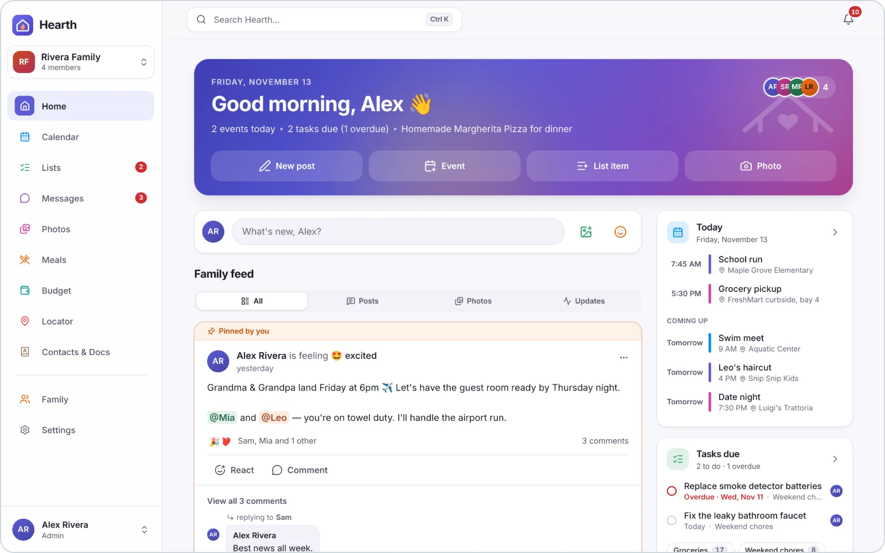
  </picture>
</p>

<p align="center"><sub>Screenshots show the built-in demo family (the Riveras) — every name, photo and number is made up.</sub></p>

<p align="center"><b>Try it:</b> <code>docker compose up -d</code> → <a href="http://localhost:8080">http://localhost:8080</a> · <a href="#quick-start">Quick start</a></p>

## Why Hearth

Hearth is a warm, modern alternative to apps like FamilyWall: one place for everything a household shares.

- **Private and self-hosted** — runs on your own computer, NAS or small server. Your family's data stays in one SQLite file you control; no accounts with anyone else, no ads, no tracking.
- **Live on every device** — add milk to the list on your phone and it appears on the kitchen tablet instantly.
- **Made for phones** — install it to your home screen like an app, with bottom navigation and swipe-friendly sheets. Works just as well on a laptop. Light and dark mode.
- **Safe with sensitive things** — documents, info cards and imported bank data are encrypted at rest, and anyone can turn on two-factor login.
- **Grown-ups and kids** — roles for admins, members and children; kids never see imported bank statements.
- **Free and simple to run** — one Node process (or one Docker container), no native dependencies and no cloud services to sign up for (only the Locator's street map loads tiles from OpenStreetMap).

## Features

### 🏠 Home

A family wall for posts, photos and moods, with reactions and comments. Beside it: today's plans, tasks that are due and what's for dinner.

<p>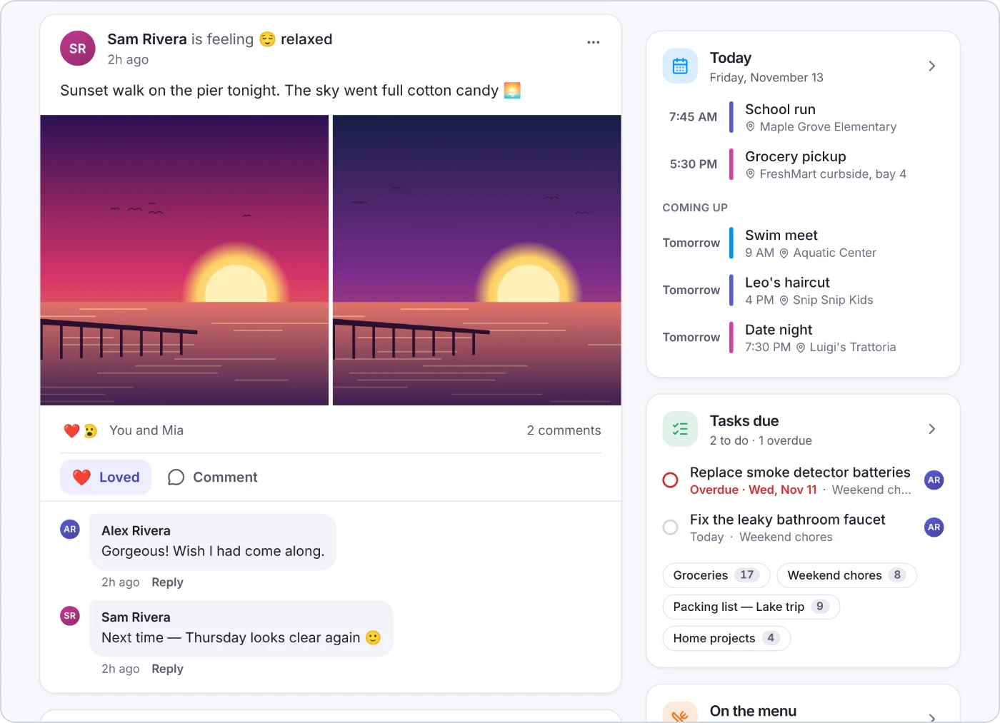</p>

### 📅 Calendar

Color-coded events for each person, birthdays, repeating events and multi-day trips, in month, week, day or agenda view.

<p>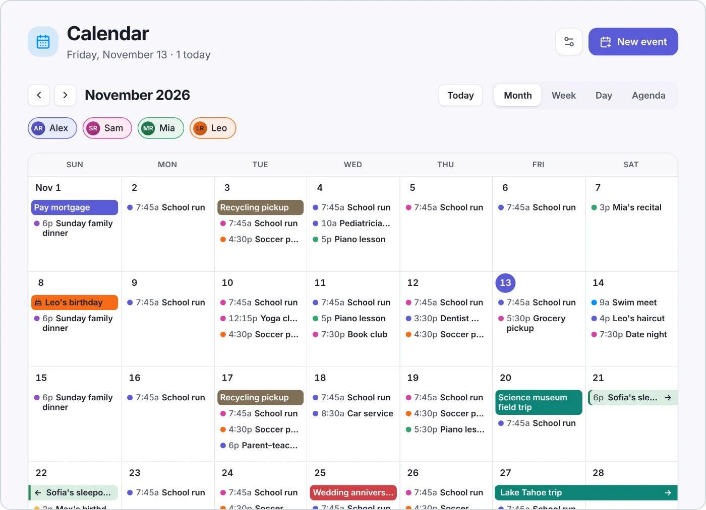</p>

### ✅ Lists

Groceries sorted by aisle, plus to-dos and chores with due dates and people assigned. Everyone sees items ticked off as they happen.

<p>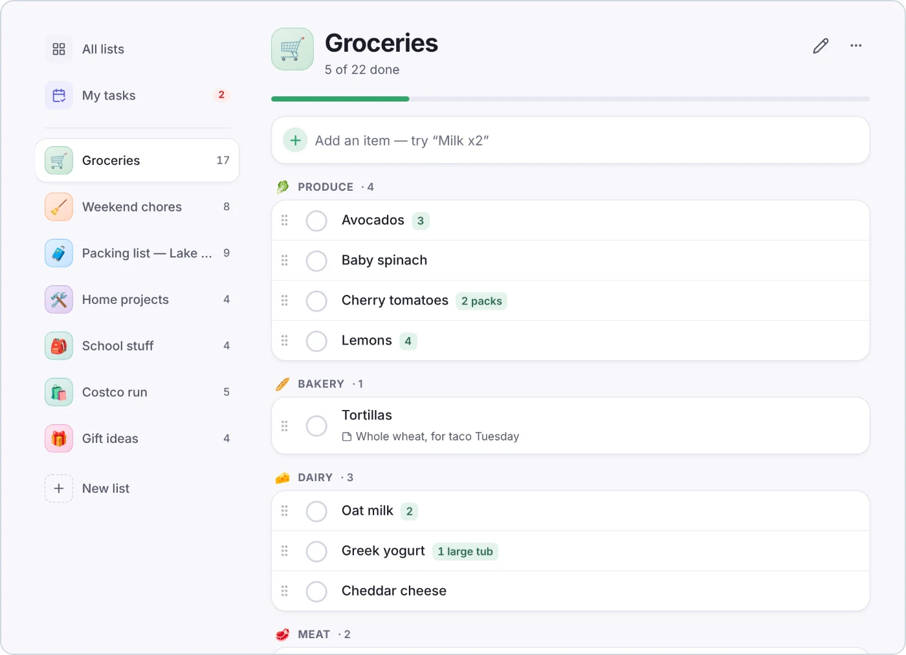</p>

### 💬 Messages

A family chat plus private messages and groups, with replies, reactions, photos and read receipts.

<p>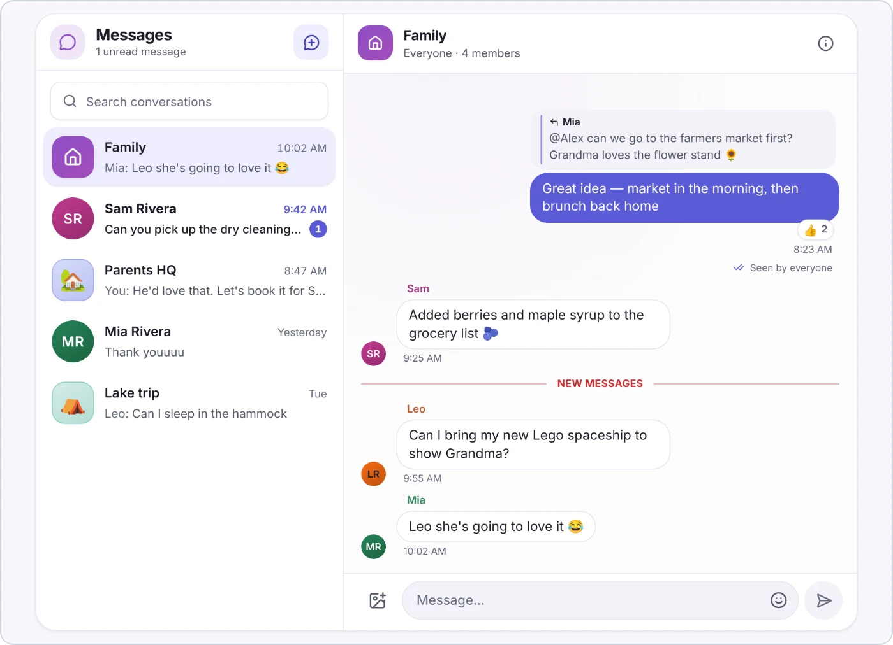</p>

### 🖼️ Photos

Shared albums that anyone in the family can add to, with a full-screen viewer.

<p>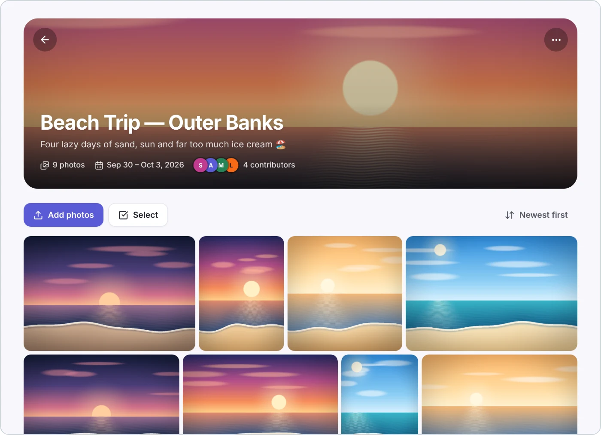</p>

### 🍽️ Meals

A family recipe box with cooking mode. Plan the week from it, then turn the plan into a shopping list in one tap.

<p>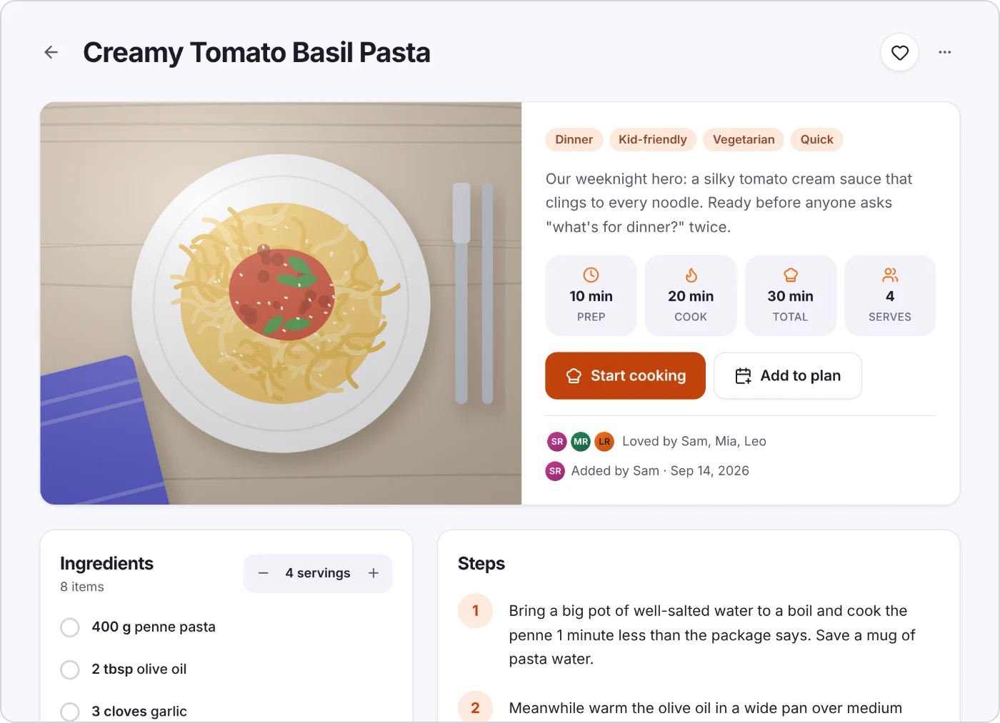</p>

### 💰 Budget

Track shared spending by category against monthly limits, with bills and savings goals that top themselves up each month. Insights shows your monthly averages, flags unusual spending and answers “can we afford our goals?”.

<p>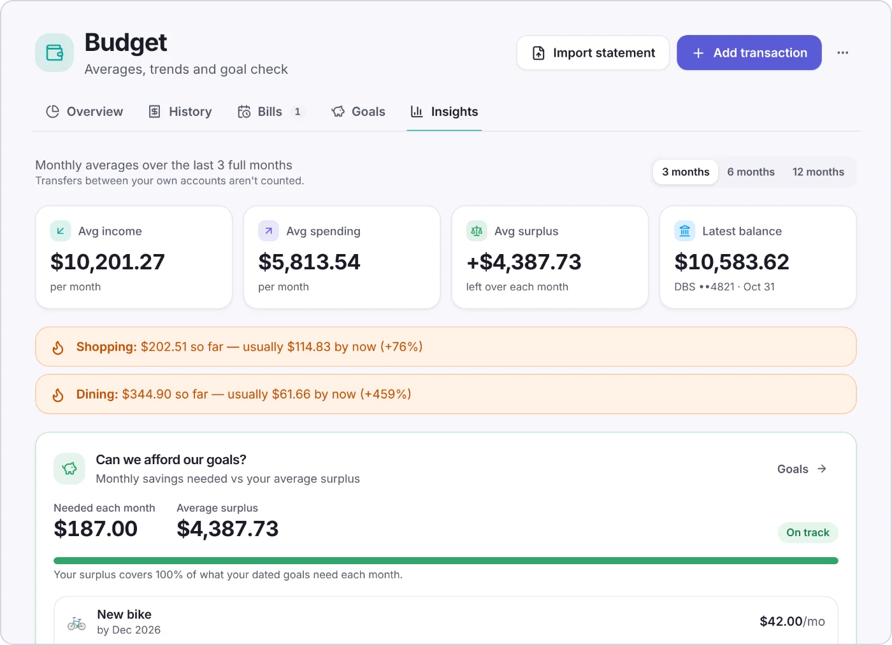</p>

You can also **import bank statements** from DBS/POSB and UOB: PDF e-statements (password-protected ones too), CSV or Excel. Merchants get Singapore categories automatically, and duplicates and monthly bills are spotted for you. The statement is read in memory and never stored ([details](#bank-statements)).

<details>
<summary><b>See the import review step</b></summary>
<p>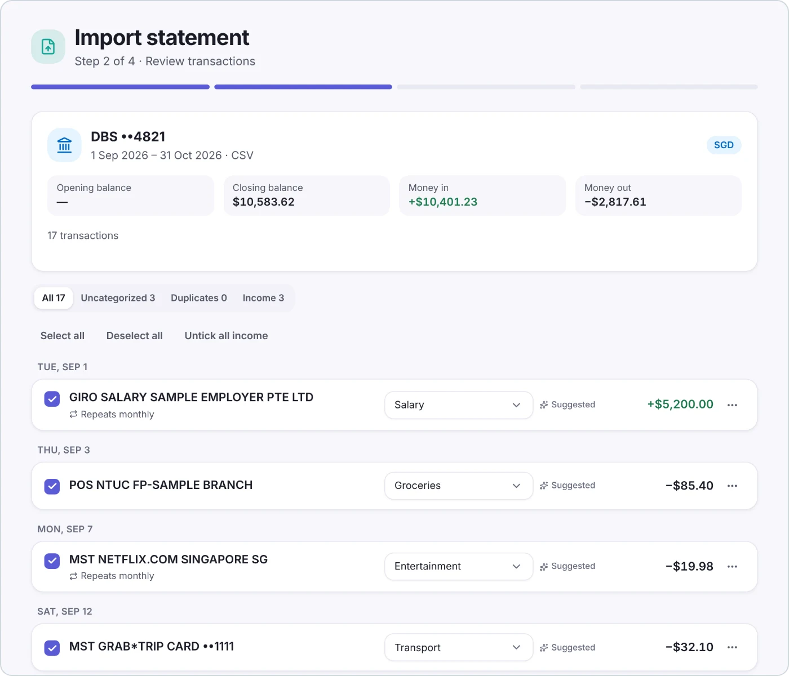</p>
</details>

### 📇 Contacts &amp; Docs

Important numbers, an encrypted document vault and info cards for Wi-Fi, insurance, medical details and door codes. Secret fields stay hidden until you tap. Anyone can also turn on [two-factor login](#two-factor-login) with an authenticator app.

<p>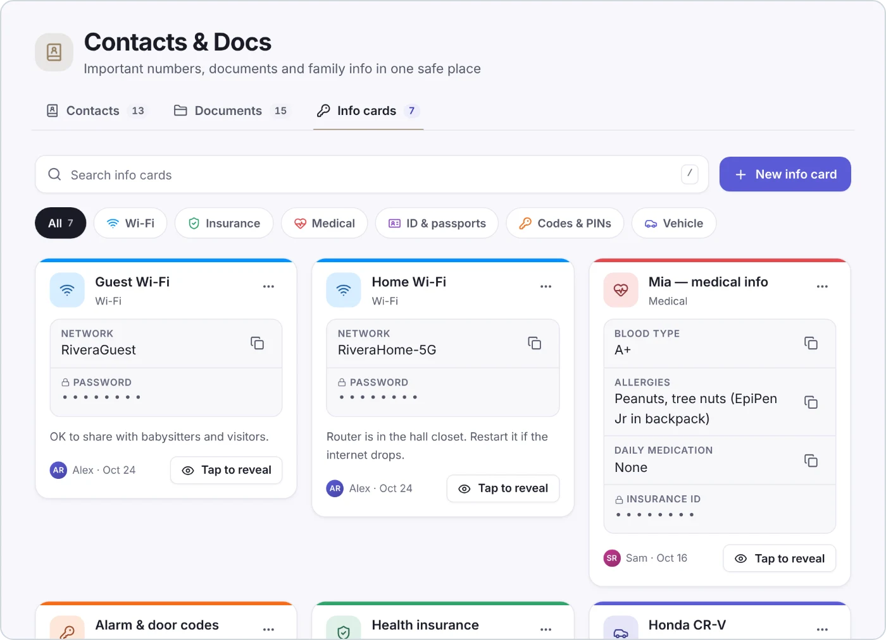</p>

**Also included:** 📍 **Locator** for check-ins at saved places and optional live location sharing on an OpenStreetMap map, plus notifications, search across everything, and roles for grown-ups and kids.

## On your phone

Open Hearth in your phone's browser and choose **Add to Home Screen**. It installs like an app, with a bottom bar, big touch targets and sheets that slide up from the bottom.

<p align="center">
  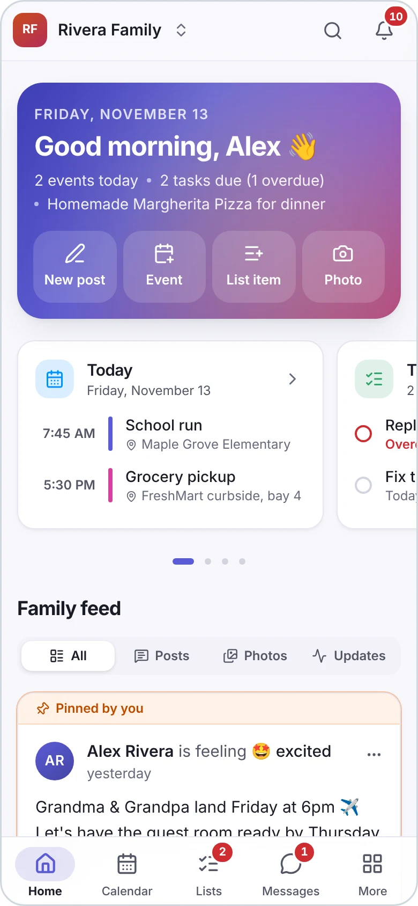
  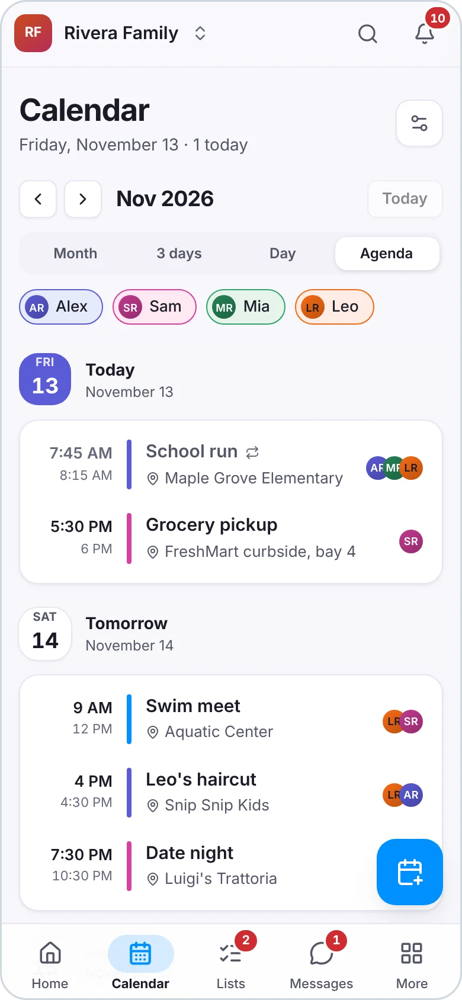
  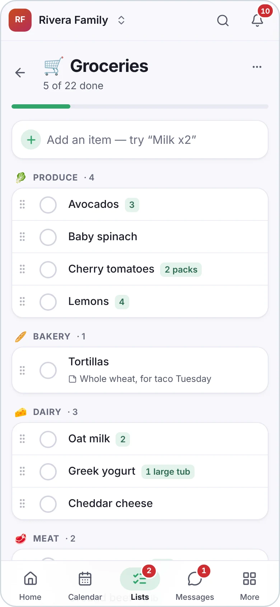
</p>
<p align="center">
  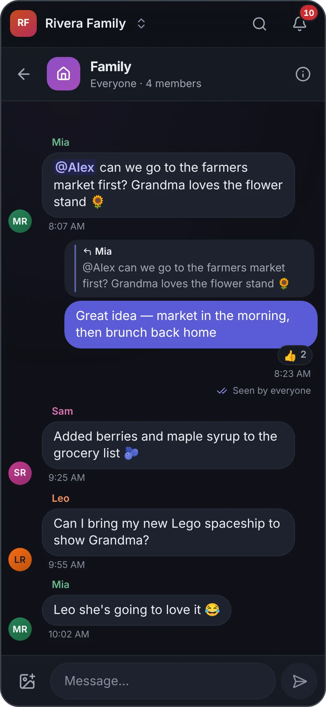
  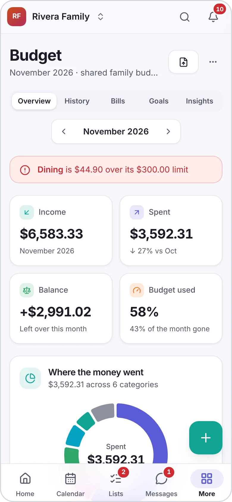
  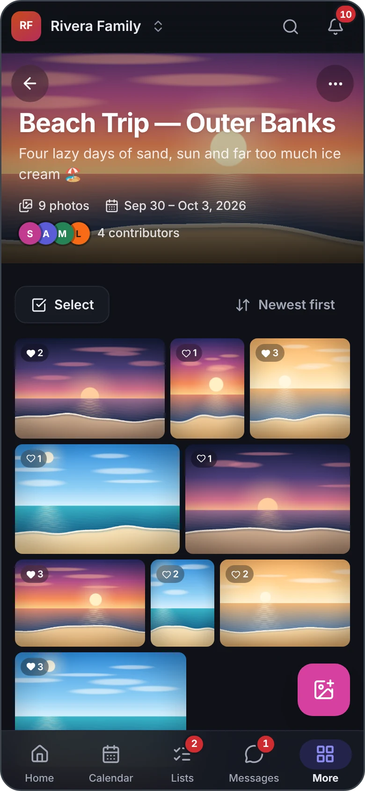
</p>

## Quick start

### Run it with Docker

```bash
git clone https://github.com/TruthFool30/Claude-Github-Repo.git hearth && cd hearth
docker compose up -d     # builds the image and serves http://localhost:8080
```

Open **http://localhost:8080** and create your account and family. Want to look around first? Load the demo family:

```bash
docker compose run --rm hearth node --disable-warning=ExperimentalWarning server/src/seed.js
```

Without Compose: `docker build -t hearth . && docker run -d -p 8080:8080 -v hearth-data:/app/data hearth`.

### Run it with Node

Requires **Node 22.13+** (Hearth uses the built-in `node:sqlite`). No native dependencies.

```bash
npm install
npm run build     # builds the web app into client/dist
npm run seed      # optional: creates the demo "Rivera Family"
npm start         # serves the app on http://localhost:8080
```

For development, `npm run dev` runs the API on :8080 and the web app with hot reload on **http://localhost:5173**.

### Demo logins

After seeding, sign in with any of these (password for all: **`hearth123`**):

| Person | Email | Role |
|---|---|---|
| Alex Rivera | `alex@hearth.test` | admin |
| Sam Rivera | `sam@hearth.test` | member |
| Mia Rivera | `mia@hearth.test` | child |
| Leo Rivera | `leo@hearth.test` | child |

The demo family's invite code is `HRTH-2026`. Re-running the seed recreates the demo family from scratch (other families are left untouched).

## Hosting

<details>
<summary><b>Docker details</b>: data volume, backups, health check</summary>

Everything Hearth stores (the SQLite database and uploaded files) lives in the `hearth-data` volume mounted at
`/app/data`, so it survives rebuilds and restarts. **Back that volume up**, or the `data/` folder when running with
Node. The vault's encryption key is generated into that volume too (`/app/data/hearth.key`) unless you set
`HEARTH_ENCRYPTION_KEY` in `docker-compose.yml`. Read [Encryption at rest](#encryption-at-rest) to decide whether the
key belongs in the same backup. The container runs as the unprivileged `node` user and has a health check on
`/api/health`.

</details>

<details>
<summary><b>Behind a reverse proxy (HTTPS)</b></summary>

Put Hearth behind any reverse proxy with HTTPS and set `COOKIE_SECURE=1` so the session cookie is marked `Secure`. If the
proxy runs in another container or on another host, set `TRUST_PROXY` (e.g. `1`) so rate limiting sees real client IPs.
With Docker, set both in `docker-compose.yml`.

Live updates use Server-Sent Events: disable response buffering on the proxy for `/api/stream` (Hearth already sends
`X-Accel-Buffering: no` for nginx).

</details>

## Configuration

| Env var | Default | Purpose |
|---|---|---|
| `PORT` | `8080` | HTTP port |
| `DB_PATH` | `./data/hearth.db` | SQLite database file |
| `UPLOAD_DIR` | `./data/uploads` | Uploaded files (served only to family members) |
| `CLIENT_DIST` | `client/dist` | Built web app to serve |
| `COOKIE_SECURE` | unset | `1` to mark the session cookie `Secure` (HTTPS) |
| `TRUST_PROXY` | `loopback` | Which reverse proxies may set `X-Forwarded-For` (used for rate limiting): `true`, `false`, a hop count like `1`, or a comma list of names/subnets (`loopback, 10.0.0.0/8`) |
| `HEARTH_ENCRYPTION_KEY` | unset | Encryption-at-rest key, 32 bytes as 64 hex chars or base64 (`openssl rand -base64 32`). Unset: a key file is used (see [Encryption at rest](#encryption-at-rest)) |
| `KEY_FILE` | `hearth.key` next to `DB_PATH` | Where the generated key file lives when `HEARTH_ENCRYPTION_KEY` is unset |
| `HEARTH_RATE_LIMITS` | on | `off` disables all rate limits (sign-in, register, join, two-factor codes, statement previews) — test instances only |
| `HEARTH_DEMO_TZ` | `America/Chicago` | (seed and tests) Time zone the demo family is seeded in; the e2e and screenshot scripts use it as the browser's time zone |
| `API_PORT` | `8080` | (dev only) where Vite proxies API calls |

Relative paths resolve against the repository root.

## Security and privacy

### Two-factor login

Anyone can turn on two-factor login under **Settings → Two-factor login**: scan the QR code with an authenticator app
(Google Authenticator, 1Password, Authy, …), enter a code, and save the 10 one-time recovery codes. After that, signing
in asks for a code from the app (or a recovery code) after the password. Turning it on signs out your other devices.

<details>
<summary><b>Locked out?</b> Reset two-factor login for an account</summary>

If someone lost their phone *and* their recovery codes, whoever runs the server can turn it off for that account:

```bash
npm run reset-2fa -- someone@example.com        # uses the same DB_PATH as the server
# Docker: docker compose exec hearth node --disable-warning=ExperimentalWarning server/src/reset-2fa.js someone@example.com
```

Authenticator secrets are stored encrypted with the instance key (`HEARTH_ENCRYPTION_KEY` or the key file next to the
database); if that key is lost, reset 2FA the same way.

</details>

### Encryption at rest

The most sensitive data is encrypted on disk with AES-256-GCM. **Keep a copy of the key somewhere safe — losing it
means losing the encrypted files and cards.**

<details>
<summary><b>What is encrypted, where the key lives, and how to keep it out of backups</b></summary>

- **Encrypted:** every document file in the vault (**Contacts & Docs**), the free-text notes on documents, and the
  contents (fields, secret or not, and text) of every info card.
- **Also encrypted:** the description and running balance of every transaction imported from a bank statement, an
  import's opening/closing balances, and the learned merchant → category choices.
- **Not encrypted:** document names and info-card titles/types (listings and search need them), imported transactions'
  date, amount, type and category, contacts, photos, receipts, avatars, messages and everything else in the database.

The key comes from `HEARTH_ENCRYPTION_KEY` if set. Otherwise Hearth creates a random key on first start in `hearth.key`
next to the database (mode 0600; override the location with `KEY_FILE`). Data from older versions is encrypted
automatically on the next start (backups taken before that still hold it unencrypted). Replaced plaintext files are
deleted, but the filesystem frees their old disk blocks without wiping them, so disk images taken before the upgrade may
still contain them. A vault file Hearth can't rewrite (e.g. wrong permissions) is left unencrypted and logged at startup.

- **Losing the key means losing those files and cards** — there is no recovery. Keep a copy of the key somewhere safe
  (e.g. your password manager).
- Hearth checks the key on every start and refuses to run with the wrong one, or when `hearth.key` is missing for a
  database that already holds encrypted data, rather than creating a new key. Restore the original key to fix it.
- For real protection keep the key **out of your backups**: anyone holding a backup that includes `hearth.key` can
  decrypt everything. Set `HEARTH_ENCRYPTION_KEY` from your host's secret store, or point `KEY_FILE` at a Docker secret
  (e.g. `/run/secrets/hearth_key`), or exclude `hearth.key` when backing up `data/` and store the key separately. To
  move an existing install to the env var, set `HEARTH_ENCRYPTION_KEY` to the contents of its `hearth.key` (then move
  the file out of `data/`).

</details>

### Bank statements

Budget can import DBS/POSB and UOB bank statements — PDF e-statements (password-protected ones too) or CSV / Excel
`.xlsx` exports — with automatic Singapore merchant categories, duplicate and monthly-bill detection, and money insights
(averages, spikes, whether your savings goals fit).

<details>
<summary><b>How statements are handled</b></summary>

- The uploaded statement is read in memory (max 10 MB) by a separate, short-lived process with a memory cap, a
  20-second limit and no access to Hearth's environment; it is **never written to disk or logged**, and nothing in it is
  executed. A PDF password is used once to open the file and never stored or logged.
- Only date, description, amount, type and running balance are kept. The account number is reduced to its last 4
  digits ("DBS ••4821"); names and addresses are never read. Any run of 8 or more digits in a description (card,
  account and phone numbers) is stored as "••" + its last 4 digits.
- Imported rows are visible to the grown-ups (default) or only to whoever imported them — never to children —
  everywhere: lists, totals and charts, search, the dashboard, insights, bills made from an import and the Wall (one
  "imported N transactions from DBS ••4821" entry for the same people). Someone leaving the family takes their private
  imports with them.
- Legacy Excel `.xls` files are refused (no safe reader); export CSV instead. Use Hearth over HTTPS when uploading
  statements from outside your home network.

</details>

### Rate limits

Sign-in attempts, registrations, invite lookups and joins are rate limited by client IP (sign-in failures also per
email), wrong two-factor codes per account, and statement previews per person. Behind a reverse proxy, set
`TRUST_PROXY` so the real client IP is used. `HEARTH_RATE_LIMITS=off` turns the limits off — for test instances only.

## Development

<details>
<summary><b>Scripts</b></summary>

| Command | What it does |
|---|---|
| `npm run dev` | API (nodemon, port 8080) + Vite dev server (port 5173, proxies `/api` and `/uploads`) |
| `npm run build` | Type-checks and builds the client into `client/dist` |
| `npm start` | Runs the server; serves `client/dist` with SPA fallback when it exists |
| `npm test` | Server API tests (`node --test server/test/*.test.js`) |
| `npm run seed` | Creates/recreates the demo family in the database |
| `npm run reset-2fa -- <email>` | Turns off two-factor login for one account (lockout escape hatch) |
| `npm run typecheck` | `tsc --noEmit -p client` |
| `npm run e2e` | Playwright regression checks against a running seeded instance (`BASE=http://localhost:8080`) |
| `scripts/e2e-all.sh` | Every e2e script, each against its own freshly seeded server (after `npm run build`; needs `npx playwright install chromium`) |
| `npm run screenshots` | Re-captures the README screenshots into `docs/screenshots/` (see below) |

</details>

<details>
<summary><b>Updating the screenshots</b></summary>

The images in this README come from `scripts/screenshots.mjs`, which drives Chromium (Playwright) through the demo
family on a freshly seeded production build — never real data:

```bash
npm run build
DB_PATH=/tmp/hearth-shots/hearth.db UPLOAD_DIR=/tmp/hearth-shots/uploads npm run seed
DB_PATH=/tmp/hearth-shots/hearth.db UPLOAD_DIR=/tmp/hearth-shots/uploads PORT=4800 HEARTH_RATE_LIMITS=off npm start
# in another terminal:
BASE=http://localhost:4800 npm run screenshots      # ONLY=hero,lists,... for a subset
```

It needs a fresh seed each run (it imports the synthetic statement in `server/test/fixtures/statements/dbs.csv`),
and Chromium for Playwright (`npx playwright install chromium`, or `CHROMIUM=/path/to/chrome`). Shots are taken at 2×;
feature shots are cropped to the page content, and all are saved as WebP with a thin border and rounded corners.

</details>

<details>
<summary><b>Continuous integration</b></summary>

GitHub Actions (`.github/workflows/ci.yml`) runs the typecheck, the build and the server tests (as a UTC, a US and an
Asian server) on every push to `main` and every pull request; pull requests also run all browser tests
(`scripts/e2e-all.sh`). Results show as checks on the pull request.

</details>

<details>
<summary><b>Tech stack</b></summary>

Node 22 + Express 5 + `node:sqlite`, cookie sessions with scrypt password hashing, Server-Sent Events for live updates ·
React 19 + TypeScript + Vite + Tailwind CSS v4 + TanStack Query + React Router 7 · Leaflet maps · Recharts charts.

A single Node process serves the API and the web app; data lives in one SQLite file.

</details>

See [`docs/ARCHITECTURE.md`](docs/ARCHITECTURE.md) for the architecture, API contract and the module author guide.
